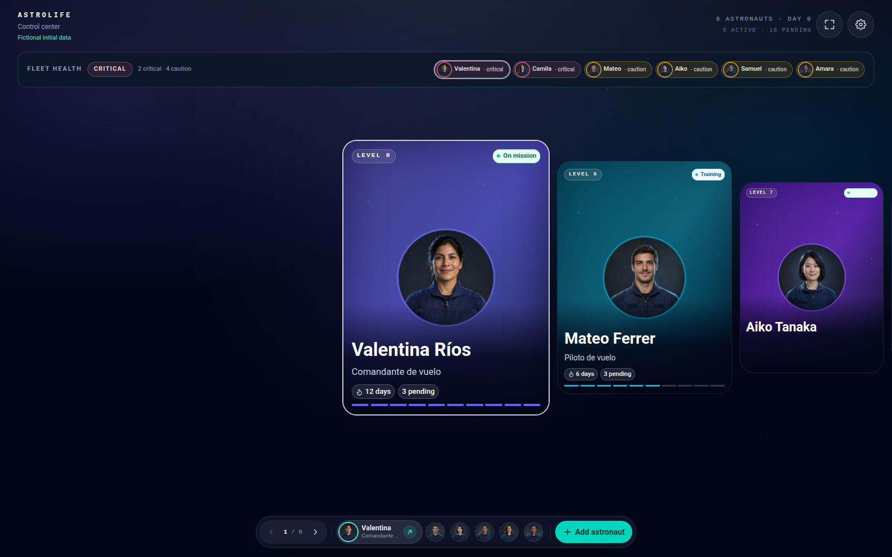
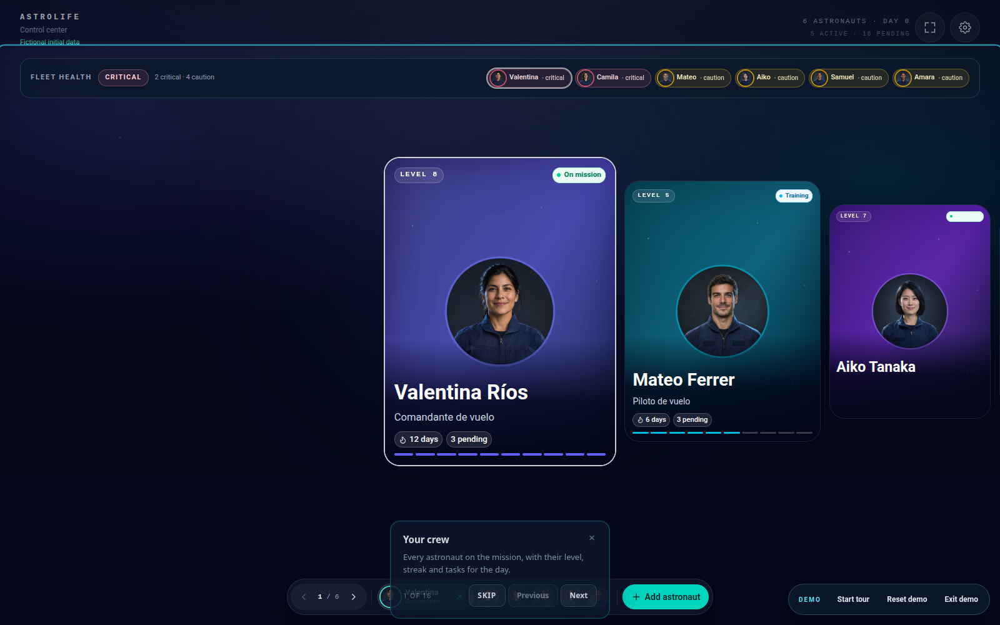
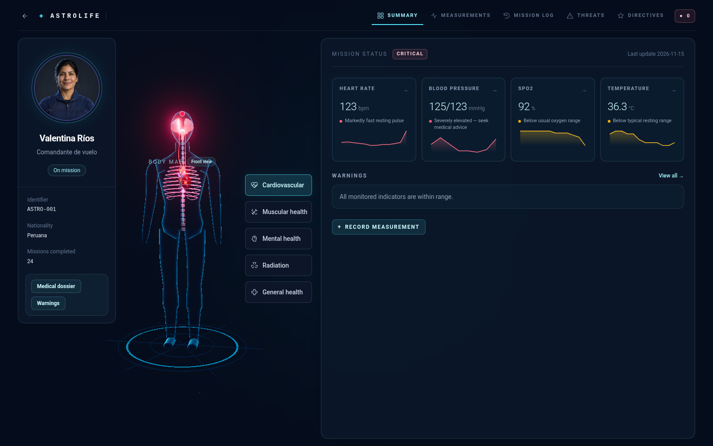
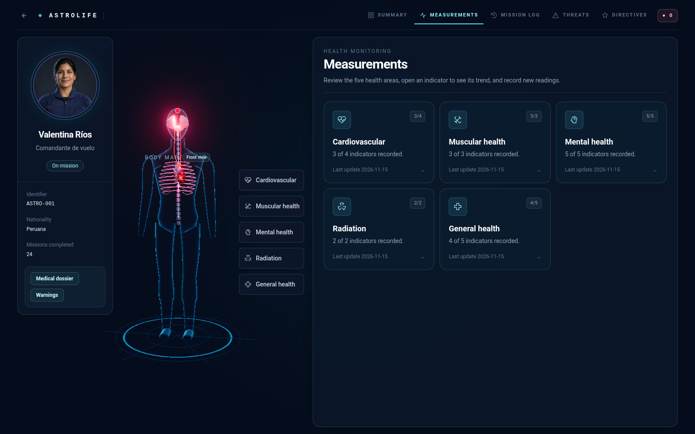
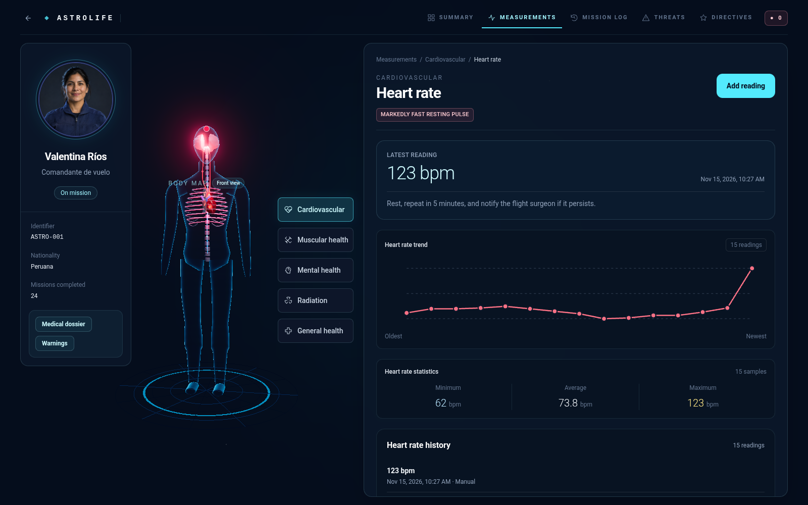
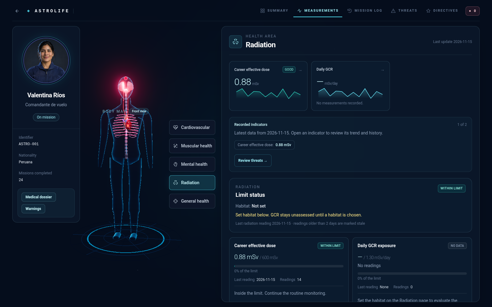
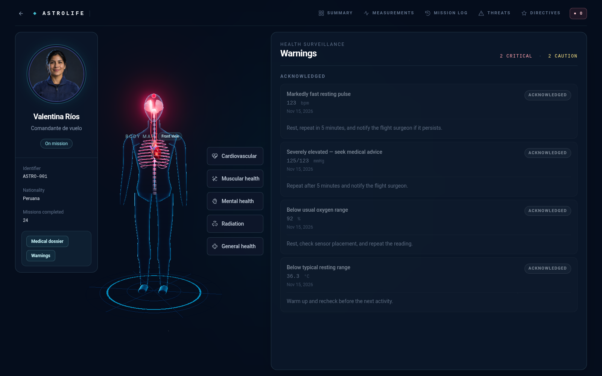
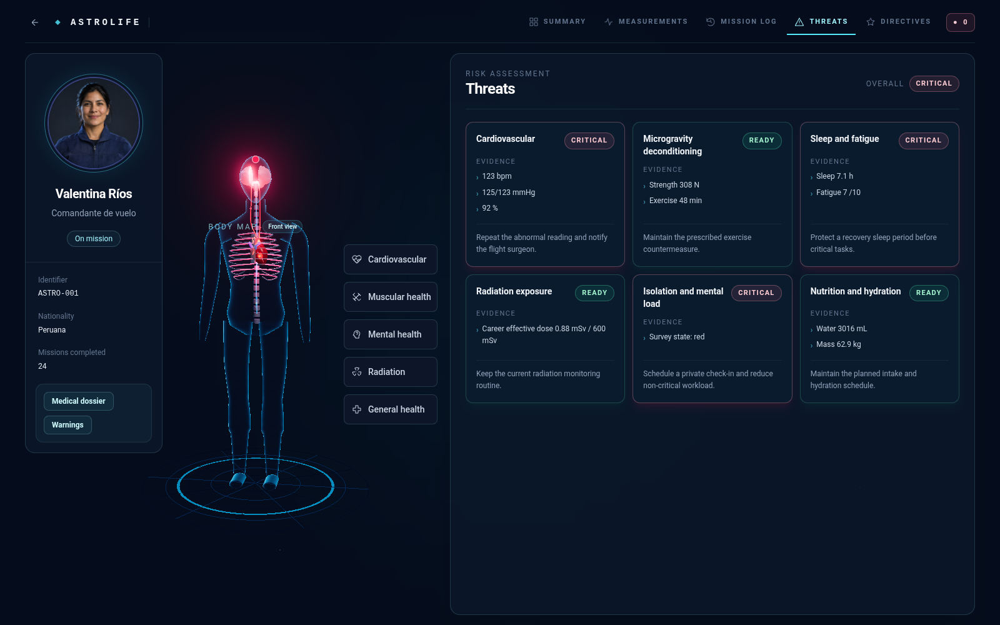
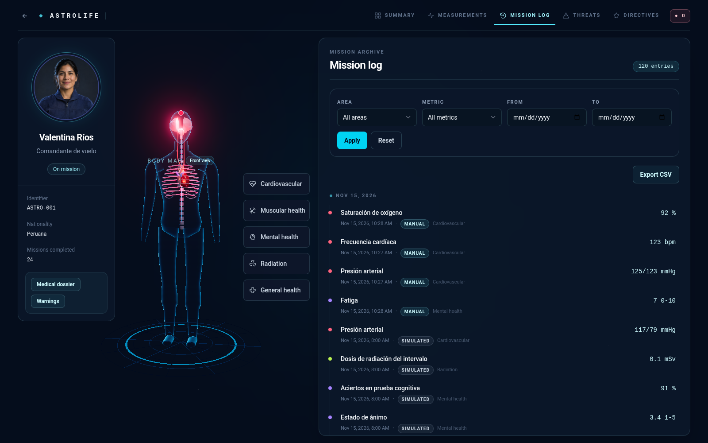
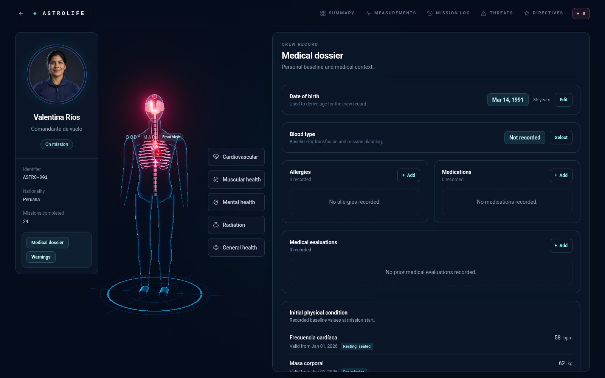

# Astrolife

**Health monitoring for astronauts on long-duration space missions.**

Astrolife is a web application that captures, evaluates and visualises the
physiological and psychological condition of a crew in near real time, and
escalates early warnings to the crew and to the flight surgeons on the ground.
It was built for **NASA Space Apps Challenge Piura 2026 — Challenge 4: create
health-monitoring software for astronauts on space missions.**

> **Demo content, not medical records.** All crew data is synthetic test data
> and the crew portraits are AI-generated images. See
> [Demo data and AI-generated assets](#demo-data-and-ai-generated-assets).



## Contents

- [Demo data and AI-generated assets](#demo-data-and-ai-generated-assets)
- [The challenge](#the-challenge)
- [What Astrolife does](#what-astrolife-does)
- [Guided demo](#guided-demo)
- [Screenshots](#screenshots)
- [Architecture](#architecture)
- [Tech stack](#tech-stack)
- [Data model](#data-model)
- [Getting started](#getting-started)
- [Build and distribution](#build-and-distribution)
- [Built with OpenCode](#built-with-opencode)
- [Team](#team)

## Demo data and AI-generated assets

Nothing in this repository comes from a real astronaut or a real patient. The
app is a hackathon prototype and every number you see is **generated test
data**.

**Crew data.** The six crew members (`Valentina Ríos`, `Mateo Ferrer`,
`Aiko Tanaka`, `Samuel Duarte`, `Camila Sosa`, `Amara Okafor`) are fictional.
Their identities, measurements, alerts, radiation doses and medical notes are
seeded for the demo: on an empty database `src/lib/server/crew-seed.ts` writes
the roster and `bd.sql` ships the metric definitions, and the trend history is
produced with `scripts/seed-cardiovascular-demo.*`. The guided demo goes one
step further and serves a frozen snapshot from
`src/lib/demo/mock-data.json` instead of the database. None of these values are
clinically validated; the reference ranges and thresholds come from the
team's research in the project brief, not from a medical device.

**Crew portraits.** The six photographs in `static/images/astronauts/` are
**AI-generated images** of fictional people, created with an image model from
the prompts kept in `portraits-prompts.json`. They do not depict real
individuals — each prompt explicitly states "not a real public figure".

**Screenshots.** Every capture in `docs/screenshots/` is a real screenshot of
this application running, so it shows the seeded demo crew and not real data.

## The challenge

Spaceflight changes the body in ways that have no terrestrial equivalent.
Microgravity degrades muscle mass and bone density; radiation raises the risk
of long-term cellular damage; fluid shifts and cardiovascular deconditioning
appear within days; light/dark cycles break the circadian rhythm; and
isolation wears down mood and cognitive performance.

On a long mission there is no hospital and no evacuation. The crew has to be
monitored continuously, and a small deviation has to be detected before it
becomes an emergency. Astrolife addresses that gap with a single panel that
records measurements per astronaut, compares them against individual reference
ranges, and produces graded warnings instead of raw numbers.

## What Astrolife does

### Walking through the app

**Crew roster (`/`)** — the control centre. The fleet health banner summarises
the whole crew (critical / caution), and each card shows the astronaut's level,
mission status, days in mission and pending tasks. From here you add, edit or
remove crew members, complete their tasks, pick a profile and open the settings
dialog. The layout is keyboard navigable and adapts to mobile.

**Astronaut summary (`/crew/[id]`)** — the health of one person at a glance:
identity card, the 3D anatomical body map, the five health areas as quick
switches, and the mission status with the four key vitals (heart rate, blood
pressure, SpO₂, temperature), their sparklines, and the open warnings.

**Measurements (`/crew/[id]/measurements`)** — the five health areas with how
many indicators are recorded, their last update, and a link into each one:

| Area            | Indicators                                                               |
| --------------- | ------------------------------------------------------------------------ |
| Cardiovascular  | heart rate, blood pressure, oxygen saturation, respiratory rate          |
| Muscular health | exercise, strength, pain                                                 |
| Mental health   | stress, mood, concentration, sleep duration, fatigue                     |
| Radiation       | career effective dose, daily GCR (dose, SPE and organ dose detail pages) |
| General health  | body temperature, hydration, weight, fasting glucose, symptoms           |

Every indicator page shows the latest reading, the reference band, the trend
chart, descriptive statistics and the full history, plus an **Add reading**
dialog. Values are validated before they reach the database.

**Mental health survey (`/crew/[id]/measurements/mental/survey/...`)** — a
step-by-step self-assessment (sleep, mood, stress, concentration, fatigue) whose
answers are stored per session and summarised into a traffic-light state.

**Warnings (`/crew/[id]/alerts`)** — the health surveillance view. Alerts are
generated from alert rules against individual baselines, grouped by severity,
and can be acknowledged so the crew and the ground know they were seen.

**Threats (`/crew/[id]/risks`)** — the space-risk assessment: cardiovascular,
microgravity deconditioning, sleep and fatigue, radiation exposure, isolation
and mental load, nutrition and hydration. Each card shows its evidence (the
readings behind the verdict), a severity and a recommended countermeasure, with
an overall mission risk on top.

**Directives (`/crew/[id]/recommendations`)** — the recommendations produced
from the current state, and the ground link: a message queue that sends
directives to ground control and shows what has been sent.

**Mission log (`/crew/[id]/history`)** — the full chronological record, filtered
by area, indicator and date range, and downloadable as CSV from
`/crew/[id]/history/export`.

**Medical dossier (`/crew/[id]/medical`)** — the module 1 record: date of birth
and derived age, blood type, allergies, medications, medical evaluations,
pre-existing conditions, initial physical condition and free-form notes.

**3D body map** — a Three.js anatomical model (skin, skeleton, brain, heart and
vessels) that reacts to the crew's own data: the brain changes colour and glow
with the latest stress and fatigue, the heartbeat follows the latest heart rate,
and the figure can be dragged or rotated from the keyboard.

**Guided demo** — opening the app with `?demo=1` switches to a read-only mock
crew and starts a Driver.js walkthrough that highlights each of these screens in
order. See [Guided demo](#guided-demo).

### Module coverage

The project brief defines twelve modules. This is what the application actually
implements today:

| #   | Brief module                          | Status      | Where                                     |
| --- | ------------------------------------- | ----------- | ----------------------------------------- |
| 1   | Crew and medical profile              | Implemented | `/crew/[id]/medical`, `crew_medical_*`    |
| 2   | Vital signs monitoring                | Implemented | `/measurements/cardiovascular`, `general` |
| 3   | Physical and muscular activity        | Implemented | `/measurements/muscular`                  |
| 4   | Bone health                           | **Planned** | not implemented                           |
| 5   | Nutrition and hydration               | Partial     | water intake, weight and glucose only     |
| 6   | Sleep and rest                        | Partial     | duration and fatigue; no circadian model  |
| 7   | Psychological and cognitive wellbeing | Implemented | `/measurements/mental`, SMIA survey       |
| 8   | Anomaly detection and medical alerts  | Implemented | `alerts` + `alert_rules`                  |
| 9   | Space risk analysis                   | Implemented | `/risks`, radiation area                  |
| 10  | History and health evolution          | Implemented | `/history`, CSV export                    |
| 11  | Ground control link                   | Partial     | directives queue, no offline sync         |
| 12  | Dashboard and medical reports         | Partial     | dashboard yes; daily/weekly PDFs not yet  |

Beyond the brief, the radiation area models career effective dose, daily
galactic cosmic ray (GCR) exposure, solar particle events (SPE) and organ dose
against mission limit profiles.

## Guided demo

The app ships with a **guided tour built on [Driver.js](https://driverjs.com)**,
so a visitor can be walked through the product without reading anything first.

Open any route with `?demo=1`:

```text
http://localhost:5173/?demo=1
```

That does three things:

1. `hooks.server.ts` sets the `astrolife-demo` cookie, so the session stays in
   demo mode across navigation and reloads (8 hours).
2. The server loads a frozen snapshot from `src/lib/demo/mock-data.json`
   instead of querying SQLite, and the demo is **read-only**: any non-GET
   request is rejected with `403`, so a stray form submit can never touch the
   real database.
3. `src/lib/demo/tour.ts` starts the Driver.js tour at the step that belongs to
   the current route.



The tour has **16 steps** that cross real routes — roster, astronaut summary,
measurements, cardiovascular, heart rate, radiation and the medical dossier —
and mixes explanatory popovers with action steps that wait for the visitor to
click the highlighted control (`advanceOn: 'click' | 'submit'`). It navigates
with `goto`, waits for each target element, saves its position in
`sessionStorage` so a full page load resumes where it stopped, offers a _Skip_
button, honours `prefers-reduced-motion`, and ends with a _Try the app_ button
that opens this repository.

A floating **demo toolbar** (bottom right) exposes _Start tour_, _Reset demo_
and _Exit demo_. Resetting clears the client-side deltas and returns to the
roster; exiting drops the cookie and reloads against the real database.

For a static demo deployment, set `PUBLIC_DEMO_MODE=true` at build time and the
whole app runs in demo mode without the query parameter. Driver.js and the tour
are imported lazily, so the production bundle only loads them when the demo is
actually active.

```sh
bun run dev:demo      # every session starts in demo mode
bun run build:demo    # static SPA in .demo/build, no server required
bun run snapshot:demo # refresh mock-data.json from the local database
```

`build:demo` stages a copy of the project in `.demo/`, drops every
`+page.server.ts`, `+layout.server.ts` and `+server.ts`, replaces the server
loads with universal loads backed by the snapshot, and writes a `200.html`
fallback with `adapter-static`. The Vercel and Node builds are untouched. See
`DEMO.md` for the full walkthrough.

## Screenshots

| Astronaut summary                              | Measurements                              |
| ---------------------------------------------- | ----------------------------------------- |
|  |  |

| Heart rate indicator                    | Radiation area                         |
| --------------------------------------- | -------------------------------------- |
|  |  |

| Warnings                            | Threats                            |
| ----------------------------------- | ---------------------------------- |
|  |  |

| Mission log                          | Medical dossier                      |
| ------------------------------------ | ------------------------------------ |
|  |  |

Further captures live in `docs/screenshots/`: the five health areas
(`04`–`12`), directives (`15`) and the mobile roster (`m1`). They were taken
from a running development server with a real browser, so they show the
seeded demo crew.

## Architecture

Astrolife is a single SvelteKit application. There is no separate API: the
browser talks to the same process that owns the database, and all data access
happens in server-only modules.

```text
src/
├── app.html
├── lib/
│   ├── assets/                 # favicon and inline assets
│   ├── components/             # shared UI (health, metrics, astronaut, medical)
│   │   └── astronaut/anatomy/  # Three.js scene: skin, skeleton, organs
│   ├── data/                   # health areas and indicator definitions
│   ├── demo/                   # demo snapshot, Driver.js tour and toolbar
│   ├── interfaces/             # domain types, one file per entity
│   ├── server/                 # server-only: db, validation, queries, rules
│   ├── services/               # client-side view transitions
│   └── utils/                  # pure helpers (BMI, dates, risk math)
└── routes/
    ├── layout.css              # Tailwind entry and design tokens
    ├── (crew)/                 # roster, profile shell and its sections
    │   ├── +page.svelte        #   /            crew roster
    │   └── crew/[id]/          #   summary, measurements, alerts, risks,
    │                           #   recommendations, history, medical
    └── (app)/mediciones/       # legacy personal measurement form
```

**Request flow.** A route's `+page.server.ts` `load` calls a query module under
`src/lib/server`, which validates the session parameters, prepares a SQLite
statement and returns plain typed objects. Mutations never use `fetch`: they
are form actions, enhanced with `use:enhance`, that validate the payload, write
through a prepared statement, and either `fail(400, { values, errors })` or
`invalidateAll()` so the page reloads with fresh data from the database.
Navigation-style outcomes use `redirect(303, ...)`.

**Server boundary.** `node:sqlite` is imported only from `src/lib/server/**`.
`src/lib/utils` and `src/lib/interfaces` stay environment-agnostic, which is
why the domain logic is unit-testable without a browser or a running server.

**Demo boundary.** `hooks.server.ts` marks a request as demo, and from that
point every `load` resolves against `src/lib/demo/mock-data.json` instead of
the database while non-GET requests are refused. The real stores are never
opened during a demo session.

**Health pipeline.** `measurements` → per-metric reference ranges and
`health_baselines` → `alerts` (rule evaluation) → `risks` (aggregation across
areas) → `recommendations` (countermeasures) → `ground_messages` (queue for the
ground link). Each stage is a separate module with its own tests.

## Tech stack

| Area      | Choice                                                                           |
| --------- | -------------------------------------------------------------------------------- |
| Framework | SvelteKit 3 (configuration in `vite.config.ts`, no `svelte.config.js`)           |
| UI        | Svelte 5 with runes forced for `src/`                                            |
| Language  | TypeScript, `strict: true`                                                       |
| Styles    | Tailwind CSS 4 + `forms` and `typography` plugins                                |
| Database  | SQLite via `node:sqlite` (`DatabaseSync`), schema in `bd.sql`                    |
| 3D        | Three.js 0.187 (WebGL scene, no React wrapper)                                   |
| Tour      | Driver.js 1.14 (guided product tour, lazily imported)                            |
| Tests     | Vitest, node environment, colocated `*.test.ts`                                  |
| Quality   | ESLint + Prettier, `svelte-check`                                                |
| Runtime   | Bun 1.4 (dev, build, tests and the self-hosted server)                           |
| Adapters  | `adapter-vercel` (hosted), `adapter-node` (self-hosted), `adapter-static` (demo) |

## Data model

`bd.sql` is the schema contract and is applied idempotently on first query.
Core tables:

- `astronauts`, `missions`, `mission_crew` — identity and assignments.
- `crew_profiles`, `crew_tasks` — the roster layer: mission day, level, status
  and the task progress shown on the cards.
- `metric_definitions`, `measurements`, `measurement_components` — every
  reading, its unit and category, plus composite values (blood pressure,
  radiation intervals).
- `health_baselines` — per-astronaut reference ranges used for comparisons.
- `alert_rules`, `alerts`, `alert_acknowledgements` — detection and triage.
- `mental_survey_sessions`, `mental_survey_responses` — the SMIA survey.
- `exercise_sessions`, `symptom_records` — muscular and general-health detail.
- `crew_medical_profiles`, `crew_medical_entries`, `crew_medical_evaluations` —
  the medical dossier.
- `crew_radiation_profiles`, `ground_messages`, `app_migrations`.

Measurements are queried by `(astronaut_id, metric_code, measured_at)`; the
history index is what keeps trend charts and CSV export fast.

## Getting started

Requirements: [Bun](https://bun.sh) 1.4 or newer (Node 24 also runs the app,
Bun is what the project is built and tested with).

```sh
bun install
bun run dev          # http://localhost:5173
```

To see the app with the guided tour, open `http://localhost:5173/?demo=1`; the
[guided demo](#guided-demo) serves mock data and never writes to SQLite.

The database is created lazily at `data/astrolife.db` on the first query, and
six fictional crew members are seeded once. Set `DATABASE_PATH` to point at a
different SQLite file:

```sh
DATABASE_PATH=/var/lib/astrolife/astrolife.db bun run dev
```

Verification:

```sh
bun run check        # svelte-kit sync + svelte-check
bun run lint         # prettier --check + eslint
bun run test:unit -- --run
```

`bd.sql` documents the schema and `scripts/seed-cardiovascular-demo.*` generates
demo cardiovascular data for a profile.

## Build and distribution

The build has three targets, selected with `BUILD_TARGET`.

### Hosted server (Vercel)

```sh
bun run build        # BUILD_TARGET defaults to vercel
```

`@sveltejs/adapter-vercel` writes `.vercel/output`, ready for `vercel deploy`.
The SQLite file lives on the server filesystem, so a hosted deployment needs a
persistent volume or a writable `/data` mount; for a purely ephemeral demo the
seeded database is recreated on demand.

### Downloadable and installable (Docker image)

```sh
bun run build:node   # BUILD_TARGET=node -> adapter-node output in build/
bun run start        # serves build/ with Bun on http://localhost:3000
```

To ship it as a container:

```sh
docker build -t astrolife .
docker run -p 3000:3000 -v astrolife-data:/app/data astrolife
# or
docker compose up --build
```

The image is built with Bun, runs the standalone server with Bun, keeps the
database in the `/app/data` volume, and listens on port 3000. Environment
variables: `PORT`, `HOST`, `ORIGIN`, `DATABASE_PATH` and `BODY_SIZE_LIMIT`
(raised to 4 MB because crew photos are stored as data URLs).

### Static demo (no server)

```sh
bun run build:demo                          # -> .demo/build
BASE_PATH=/astrolife-healt bun run build:demo  # GitHub Pages project site
```

`adapter-static` writes a single-page build with a `200.html` fallback, so the
demo can be hosted on GitHub Pages, Netlify or any static bucket. It runs on the
frozen snapshot, needs no database and no server, and is the cheapest way to
show the app to a reviewer.

## Built with OpenCode

The whole application was developed with [OpenCode](https://opencode.ai): an
AI coding agent working directly in this repository, on top of the same tooling
a human contributor would use.

The workspace configuration is committed in `.opencode/`:

- **`astrolife-lead`** — the default agent. Plans the change, owns server
  routes, database access, validation and tests, and keeps the project rules in
  `AGENTS.md`.
- **`astrolife-reviewer`** — an independent read-only reviewer for database
  contracts, form actions, accessibility and regressions.
- **Svelte MCP** (`@sveltejs/mcp`) — official Svelte 5 and SvelteKit
  documentation plus a component autofixer, so every `.svelte` file is checked
  against the framework's own rules.
- **Skills** — `astrolife-patterns` encodes the project's SQLite, form-action
  and validation conventions; `svelte-mcp-feedback` feeds corrections back into
  the workflow.

Concretely, the agent wrote the schema and migrations, the query and validation
modules with their Vitest suites, the Svelte 5 components, the Three.js anatomy
scene, the Driver.js tour and demo snapshot, this deployment setup and this
document. Every change was verified with
`bun run check`, lint, the test suite and a smoke test of the affected flow
before being committed.

In the interest of transparency: the AI did not invent the medical criteria.
Reference ranges, alert thresholds and the risk model come from the team's
research in the project brief, and the crew data and portraits are generated
content, clearly labelled above.

## Team

**Astrolife** — NASA Space Apps Challenge Piura 2026, Challenge 4.

- Blanca Celicia López López
- Barbara Valeria Pastori Zúñiga
- Danny Martín Gutiérrez Carmen
- Jahaziel Atoche Saavedra
- Rober Esbel Torres Tarrillo
- Wilson Manuel Vilchez Bruno

Modality: on-site · Piura, Peru · 14–15 November 2026.
